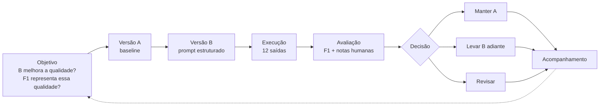

# Análise e Decisão

## Introdução

Este documento consolida as 12 saídas do experimento (6 casos × versões A e B) e apresenta a análise comparativa e a decisão, conforme o Plano GQM. A **Versão A** é o baseline (prompt direto) e a **Versão B** usa o prompt estruturado.

Os valores de F1 são os do Registro das Saídas, com τ = 0,5. As notas humanas (Correção, Relevância, Suporte e Falha Crítica) são as de `05-avaliacao.md`. Conforme o GQM, a decisão considera principalmente a avaliação humana, utilizando o F1 como indicador automático complementar.

## Tabela consolidada

| ID | F1 | Sinal | C/R/S/FC | Decisão final | Justificativa |
|---|---:|---|---|---|---|
| CT01-A | 0,636 | Aprova | 2/2/2/0 | Aprovada | Valor correto de R$ 50,00 por dia útil. |
| CT01-B | 0,452 | Reprova | 2/2/2/0 | Aprovada | Valor correto, com cartão benefício e fonte. |
| CT02-A | 0,852 | Aprova | 2/2/2/0 | Aprovada | Missão recuperada e transcrita corretamente. |
| CT02-B | 0,813 | Aprova | 2/2/2/0 | Aprovada | Missão apresentada corretamente, com indicação da fonte. |
| CT03-A | 0,364 | Reprova | 2/2/2/0 | Aprovada | Receita líquida correta (R$ 48,6 milhões). |
| CT03-B | 0,000 | Reprova | 0/0/0/0 | **Reprovada** | Abstenção incorreta (falso negativo): o documento continha o dado da receita. |
| CT04-A | 0,667 | Aprova | 2/2/2/0 | Aprovada | Prazo de 90 dias informado corretamente. |
| CT04-B | 0,533 | Aprova | 2/2/2/0 | Aprovada | Prazo correto, com indicação da política de benefícios. |
| CT05-A | 0,000 | Reprova | 2/2/2/0 | Aprovada | Abstenção correta: não há informação sobre o valor do bônus nos documentos disponíveis. |
| CT05-B | 0,000 | Reprova | 2/2/2/0 | Aprovada | Abstenção correta, com a limitação declarada. |
| CT06-A | 0,335 | Reprova | 2/2/2/0 | Aprovada | Valor correto, acompanhado de regras adicionais de crédito e desconto. |
| CT06-B | 0,292 | Reprova | 2/2/2/0 | Aprovada | Valor correto e condições de concessão. |

## Concordância e métricas por versão

A comparação considera seis casos por versão. A aprovação humana ocorre quando Correção, Relevância e Suporte recebem nota 2, sem falha crítica. A aprovação automática ocorre quando F1 é igual ou superior a 0,5.

| Indicador | Versão A | Versão B |
|---|---:|---:|
| Média do F1 | 0,476 | 0,348 |
| Mediana do F1 | 0,500 | 0,373 |
| Aprovação automática | 3/6 (50,0%) | 2/6 (33,3%) |
| Aprovação humana | 6/6 (100%) | 5/6 (83,3%) |
| Falhas críticas | 0 | 0 |

A Versão A apresentou média e mediana de F1 superiores às da Versão B. Na avaliação humana, a Versão A foi aprovada nos seis casos, enquanto a Versão B foi aprovada em cinco, com reprovação no CT03-B.

A concordância entre o sinal automático e a decisão humana foi de **1 em 12 casos (8,3%)**. O único caso de concordância foi CT03-B, reprovado tanto automaticamente quanto na avaliação humana. Nos outros 11 casos, o F1 indicou reprovação, embora a avaliação humana tenha aprovado as respostas.

A concordância entre R1 e R2 foi de **4 em 4 casos (100%)**, conforme registrado em `05-avaliacao.md`. Os dois avaliadores atribuíram as mesmas pontuações aos quatro casos selecionados: CT01-A, CT01-B, CT05-A e CT05-B.

## Gráfico

- [Aprovação Humana](../evidencias/graficos/grafico_aprovacao_humana.png)
- [F1 Lexical](../evidencias/graficos/grafico_f1_lexical.png)

## Análise de divergências e casos-limite

O principal caso de divergência entre as avaliações automática e humana ocorreu nas respostas aprovadas pelos avaliadores, mas reprovadas pelo F1. Isso aconteceu porque a métrica considera a sobreposição lexical entre a resposta e a referência, não sendo capaz de reconhecer plenamente equivalência de significado ou correção factual.

O CT05 ilustra essa limitação. As duas versões realizaram a abstenção esperada, pois os documentos disponíveis não apresentavam o valor do bônus anual por desempenho pago em 2025. Apesar disso, ambas receberam F1 igual a zero. A avaliação humana considerou as duas respostas corretas, relevantes e sustentadas pela ausência de evidência nos documentos.

Outro caso importante é o CT06. As respostas das duas versões foram consideradas corretas pelos avaliadores, mas ficaram abaixo do limiar de F1. A presença de informações adicionais sobre o benefício aumentou a diferença entre as respostas e a referência curta, sem representar necessariamente um erro factual.

O CT03-B representa o principal problema funcional identificado na Versão B. Embora o relatório financeiro contenha a receita líquida de R$ 48,6 milhões, a resposta afirmou que não foi possível determinar o valor. Trata-se de um falso negativo: o sistema deixou de recuperar uma informação disponível na base documental. Por isso, o caso recebeu notas zero em Correção, Relevância e Suporte na avaliação humana.

Também é importante observar que CT06 é uma paráfrase do CT01, e não uma observação totalmente independente. Os dois casos verificam essencialmente a recuperação do mesmo valor de vale-refeição, com formulações diferentes. Assim, o conjunto possui seis casos registrados, mas não seis objetivos de informação completamente distintos.

Não foram registradas falhas críticas nas avaliações humanas. Entretanto, a falha média identificada em CT03-B continua relevante, pois demonstra que o prompt estruturado não impediu uma abstenção incorreta diante de evidência disponível.

## Diagrama do ciclo de versionamento

## Decisão

Decisão: manter a Versão A como baseline

Com base nos resultados desta rodada, a decisão é **manter a Versão A como baseline e não promover a Versão B para uso como configuração preferencial neste momento**.

A decisão é sustentada pelos seguintes resultados:

- A Versão A obteve aprovação humana em 6 dos 6 casos (100%), enquanto a Versão B obteve aprovação em 5 dos 6 casos (83,3%).
- A Versão A apresentou média de F1 de 0,476, superior à média de 0,348 da Versão B.
- A Versão B apresentou uma falha de recuperação no CT03, abstendo-se incorretamente de informar a receita líquida de 2025, apesar de o dado estar disponível no documento.
- Não foram identificadas falhas críticas, mas a falha funcional no CT03-B impede considerar a Versão B superior ou pronta para substituir o baseline.

A Versão B poderá ser revisada em uma próxima rodada, com atenção especial à recuperação de informações que estão presentes nos documentos. Após o ajuste, será necessário executar novamente os casos de teste e realizar nova avaliação, mantendo as condições de comparação controladas.

O critério para uma futura promoção da Versão B deverá incluir aprovação humana nos seis casos, ausência de falhas críticas e ausência de falhas funcionais como a observada no CT03-B. O F1 deverá ser considerado em conjunto com a avaliação humana, e não como critério isolado de qualidade.

## Respostas às questões de análise

**Q1. A versão B atende melhor à tarefa do que a versão A?**

Não. A aprovação humana foi de 6/6 na Versão A e 5/6 na Versão B. A diferença corresponde à falha do CT03-B, em que a Versão B não recuperou uma informação existente no relatório financeiro. Além disso, a Versão A apresentou média de F1 superior. Portanto, nesta rodada, a Versão B não demonstrou ganho de qualidade.

**Q2. O sinal automático representa a adequação das respostas?**

Não de forma suficiente. A concordância entre o sinal automático e a avaliação humana foi de apenas 1/12 (8,3%). O F1 reprovou respostas que os avaliadores consideraram corretas, como as abstenções do CT05 e as respostas dos demais casos com redação diferente da referência. Isso demonstra que a métrica lexical deve ser utilizada como indicador complementar, não como substituta da avaliação humana.

## Limitações

- O experimento contém apenas seis casos de teste, sendo CT06 uma paráfrase de CT01. Portanto, a variedade de perguntas e de informações avaliadas é limitada.
- O conjunto de documentos é pequeno e restrito a materiais organizacionais específicos. Os resultados não garantem o mesmo comportamento em outras bases documentais.
- O F1 lexical mede sobreposição de palavras e não avalia diretamente equivalência semântica, correção factual, relevância ou qualidade da recuperação de fontes.
- A avaliação humana utiliza uma escala de 0 a 2 e foi realizada por dois avaliadores, mas R2 analisou somente quatro das doze saídas. A concordância de 100% se aplica apenas a esses quatro casos.
- O resultado do experimento representa as execuções realizadas nas condições registradas. Alterações no modelo, na versão do sistema, nos parâmetros ou nos documentos podem modificar as respostas.
- A decisão é válida para esta rodada e para os casos avaliados. Uma conclusão mais ampla exigiria maior quantidade e diversidade de perguntas, novas execuções e avaliação humana adicional.