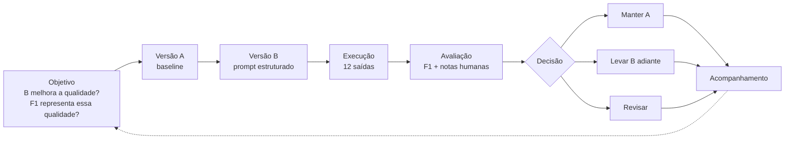

# Análise e Decisão

## Introdução

Este documento consolida as 12 saídas do experimento (6 casos × versões A e B) e apresenta a análise comparativa e a decisão, conforme o Plano GQM. A **Versão A** é o baseline (prompt direto) e a **Versão B** usa o prompt estruturado.

Os valores de F1 são os do Registro das Saídas, com τ = 0,5. As notas humanas (Correção, Relevância, Suporte e Falha Crítica) são as de `05-avaliacao.md`. Conforme o GQM, a decisão se baseia na avaliação humana.

> **Nota sobre o F1:** ao recalcular o F1 com as respostas esperadas do plano de casos de teste, os valores ficam diferentes dos registrados. Exemplo: o CT01-A dá 0,636 no recálculo e 0,076 no registro. Não foi possível confirmar quais arquivos de referência o script do grupo usou, então a tabela traz o valor do registro, e o recálculo aparece só na seção 4. Os valores recalculados estão no arquivo `anexos/f1_recalculado.json`.

## 1. Tabela consolidada

**Sinal** é o sinal automático (aprova se F1 ≥ 0,5). **Conc.** indica se o sinal automático e a decisão humana são iguais. A decisão final de CT01 e CT05 considera R1 e R2 (que concordaram); nas demais vale a nota de R1.

| ID | F1 | Sinal | C/R/S/FC | Decisão final | Conc. | Justificativa |
|---|---:|---|---|---|:---:|---|
| CT01-A | 0,076 | Reprova | 2/2/2/0 | Aprovada | ✘ | Valor correto de R$ 50,00 por dia útil. |
| CT01-B | 0,104 | Reprova | 2/2/2/0 | Aprovada | ✘ | Valor correto, com cartão benefício e fonte. |
| CT02-A | 0,189 | Reprova | 2/2/2/0 | Aprovada | ✘ | Missão recuperada e transcrita corretamente. |
| CT02-B | 0,193 | Reprova | 2/2/2/0 | Aprovada | ✘ | Missão direta, com fonte. |
| CT03-A | 0,099 | Reprova | 2/2/2/0 | Aprovada | ✘ | Receita líquida correta (R$ 48,6 milhões). |
| CT03-B | 0,000 | Reprova | 0/0/0/0 | **Reprovada** | ✔ | Abstenção incorreta (falso negativo): o documento tinha o dado. |
| CT04-A | 0,071 | Reprova | 2/2/2/0 | Aprovada | ✘ | Prazo de 90 dias correto. |
| CT04-B | 0,080 | Reprova | 2/2/2/0 | Aprovada | ✘ | Prazo correto, com citação da política. |
| CT05-A | 0,000 | Reprova | 2/2/2/0 | Aprovada | ✘ | Abstenção correta (não há dado sobre bônus). |
| CT05-B | 0,000 | Reprova | 2/2/2/0 | Aprovada | ✘ | Abstenção correta, com a limitação declarada. |
| CT06-A | 0,335 | Reprova | 2/2/2/0 | Aprovada | ✘ | Valor correto, com regras adicionais de crédito e desconto. |
| CT06-B | 0,185 | Reprova | 2/2/2/0 | Aprovada | ✘ | Valor correto e condições de concessão. |

## 2. Concordância e métricas por versão

**Concordância auto–humano:** **1/12** (8,3%). O sinal automático reprovou as 12 saídas e a avaliação humana aprovou 11. Só o CT03-B coincide.

| Medida | Versão A | Versão B |
|---|---:|---:|
| Aprovação humana (n/6) | 6/6 (100%) | 5/6 (83,3%) |
| Falhas críticas | 0 | 0 |
| F1 médio | 0,128 | 0,094 |
| F1 mediano | 0,088 | 0,092 |
| Aprovação pelo sinal automático (n/6) | 0/6 | 0/6 |

## 3. Gráfico

*Os losangos são os F1 do registro (usados nas tabelas), as barras são o F1 recalculado e a linha tracejada é τ = 0,5. Nenhuma das 12 saídas do registro chega ao limiar.*

## 4. Análise de divergências e casos-limite

**CT05 (abstenção correta com F1 = 0).** R1 e R2 aprovaram as duas abstenções (A e B), e o F1 do registro é 0,000, porque a redação da abstenção não repete as palavras da referência. O sinal automático reprova um comportamento correto.

**CT06-A (resposta correta e longa).** A resposta traz o valor certo e mais regras (crédito, desconto, acúmulo). Tem o maior F1 do registro (0,335), mas continua abaixo de τ. A mesma informação aparece no CT01-A, curta e também correta, e o F1 é diferente: o F1 mede sobreposição de palavras, não se a resposta está certa.

**CT03-B (concordância por coincidência).** O sinal reprova (F1 = 0) e a avaliação humana também. Mas a humana reprova por abstenção incorreta, enquanto o F1 dá 0 simplesmente porque não houve palavras em comum. O CT05, que é uma abstenção correta, também tem F1 = 0 e não é distinguido do CT03-B.

**Divergência entre registro e recálculo.** Com o F1 recalculado a partir das referências do plano de casos de teste, o sinal automático aprovaria CT01, CT02 e CT04 em A e B (6 saídas) e a concordância subiria para **7/12**. Mesmo assim, o sinal continuaria reprovando CT03-A, CT05 e CT06, que são respostas corretas.

## 5. Diagrama do ciclo de versionamento

## 6. Decisão: **manter A**

Critério do GQM: B só avança se a aprovação humana for maior que a de A em pelo menos 1/6 e não houver falha crítica.

- A teve **6/6** de aprovação e B teve **5/6**, então não há ganho de B.
- Não houve falha crítica em nenhuma das versões.
- O F1 de B não subiu (média 0,094 contra 0,128), então a decisão não é "revisar".

A única saída reprovada é o CT03-B, que foi uma abstenção incorreta, sem valor inventado.

## 7. Respostas às questões de análise

> **Pendente:** o texto das quatro questões do enunciado não estava nos materiais que recebi. Abaixo estão as respostas às duas perguntas do Plano GQM. Para completar a seção, cole as quatro questões do enunciado.

**Q1. A versão B atende melhor à tarefa do que a versão A?**
Não. A aprovação humana foi 6/6 em A e 5/6 em B, e a diferença é um único caso (CT03-B). B não mostrou ganho nesta rodada.

**Q2. O sinal automático representa a adequação das respostas?**
Não. A concordância foi de 1/12 com o F1 do registro (7/12 com o recálculo). O sinal reprova respostas corretas, por redação diferente (abstenção no CT05) ou por resposta longa (CT06-A).

## 8. Limitações

- **Seis casos não demonstram risco zero.** O resultado de 6/6 em A não prova que o sistema seja seguro. Cada caso vale cerca de 16,7 pontos percentuais e houve uma única execução por caso e versão.
- **CT06 não é independente.** É uma paráfrase do CT01, então há menos de seis situações distintas.
- **Pouca revisão dupla.** R2 avaliou só 4 das 12 saídas. As outras 8 dependem de um único avaliador (R1), e a concordância R1–R2 de 100% vale só para essas 4.
- **Quase todas as notas foram 2/2/2.** A avaliação humana quase não separou as saídas, e não há comparação com acaso (sem kappa).
- **F1 lexical.** Mede palavras em comum, não significado. As referências são curtas e as respostas do RAG tendem a ser mais longas.
- **Valores de F1 em aberto.** Registro e recálculo divergem (nota na introdução).
- **Documentos sintéticos.** O resultado vale para este conjunto de documentos e perguntas.

## 9. Acompanhamento

1. Conferir quais arquivos de referência o script de F1 usou e fixar um único valor oficial de F1.
2. Reexecutar o CT03-B algumas vezes para ver se a abstenção incorreta se repete.
3. Ampliar os casos, principalmente de abstenção e de paráfrase, antes de decidir sobre B.
4. Completar a seção 7 com as quatro questões do enunciado.
